# DND AI Dungeon Master by Arahort

Твоя таверна и игровой стол для **Dungeons & Dragons 5e**, где роль Мастера подземелий выполняет ИИ. Создавай героев, собирай друзей, исследуй мир и бросай кубики — всё в одном окне браузера. Можно играть одному с NPC-напарниками или вместе с компанией, с компьютера и телефона.

Это версия **DND AI Arahort для установки на собственный сервер**. Мастер и иллюстрации работают через Antigravity CLI с Google-аккаунтом владельца сервера. По умолчанию используется **Gemini 3.8 Flash, high**, озвучка — **Edge TTS**. GPU и локальная модель не нужны.

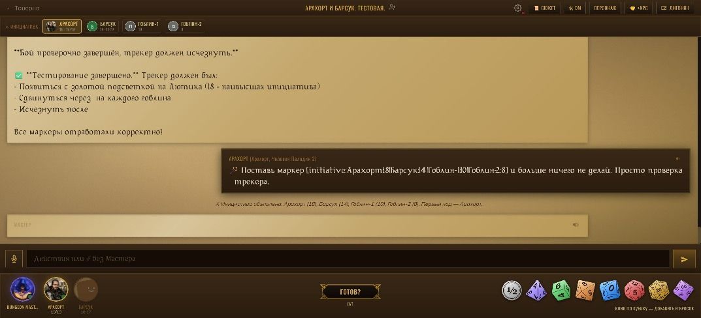

## Что есть в игре

- Создание персонажей по D&D 5e: расы, классы, характеристики, предыстория, аватар и полный лист героя.
- ИИ-Мастер, который ведёт сюжет, отыгрывает NPC и врагов, учитывает действия партии и обновляет игровые показатели.
- Общий чат, сообщения вне отыгрыша, голосовой ввод, кубики с 3D-анимацией и трекер инициативы.
- SVG-карты локаций, иллюстрации сцен, кнопки выбора и групповые голосования.
- NPC-напарники с собственной предысторией и инструкцией по отыгрышу.
- Дневник кампании: персонажи, задания, места, фракции, лор и обещания.
- Озвучка сообщений, фоновая атмосфера, звуковые эффекты и настройки читаемости.
- Наблюдатели, приглашения, перенос партий и обновление приложения из панели администратора.

## Как получить лучший игровой опыт

Сервис лучше всего подходит для **ваншотов** — законченных приключений на одну игровую сессию.

**Очень рекомендуется ещё до создания партии подготовить с помощью ИИ мир, персонажей и желаемый сюжет.** Обсуди место действия, фракции и важных NPC, мотивацию героев, их связи, завязку, ключевые события и цель приключения. Согласуйте тон истории и ограничения контента. Можно придумать собственную вселенную или подготовить приключение по знакомой книге или фильму.

При создании партии перенеси подготовленные материалы в соответствующие поля:

| Поле | Что подготовить |
| --- | --- |
| **Мир и вселенная** | Места, история, фракции, религии, NPC и особенности магии. Это справочник Мастера. |
| **Сюжет и завязка** | Начальная ситуация, связи персонажей и направление приключения. |
| **Финальный босс / цель** | Основной конфликт, противник или желаемый итог истории. |
| **Ограничения** | Договорённости группы: например, без PvP, без гибели героев или без определённых тем. |

Такая подготовка помогает Мастеру связать события и персонажей в цельную историю. Во время игры мир и сюжет можно дополнять через панель «Сюжет».

## Вход и таверна

Администратор создаёт **одноразовые коды регистрации**. Получи такой код у владельца сервера, зарегистрируйся и затем входи по логину и паролю. Код регистрации аккаунта и код приглашения в конкретную партию — разные вещи.

После входа ты попадёшь в таверну **«Гарцующий Пони»**. Здесь можно создать приключение, присоединиться по коду друга или вернуться к своим партиям. На карточках видны состав, заполненность, сеттинг, стиль, сложность и состояние игры. Смена пароля и выход из аккаунта находятся в верхней части экрана.

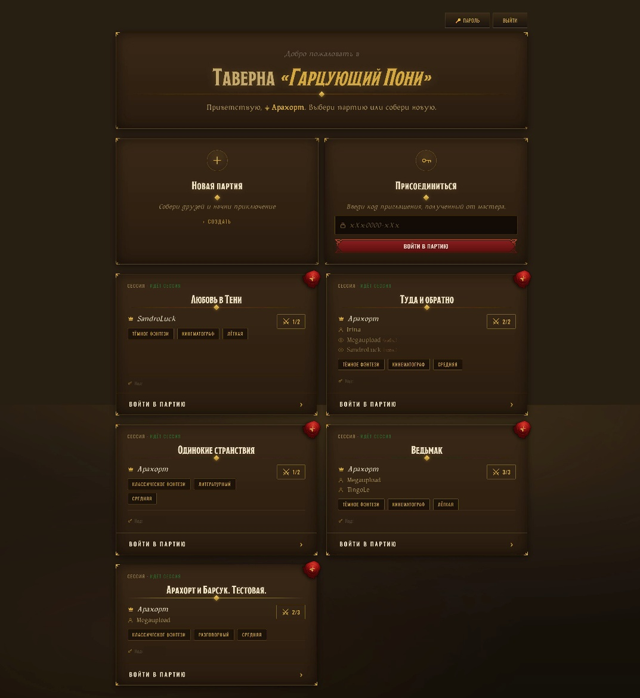

## Создание партии

Нажми **«Новая партия»**, придумай название и выбери число мест, сеттинг, сложность, стиль повествования и продолжительность. Доступны классическое и тёмное фэнтези, юмор, хоррор и sci-fi; историю можно вести эпически, кинематографично, разговорно или литературно.

Заполни мир, завязку, цель и ограничения. После создания открой **«Пригласить друзей»** и передай участникам код партии. Для зрителей есть отдельный код наблюдателя.

Посмотреть настройки новой кампании

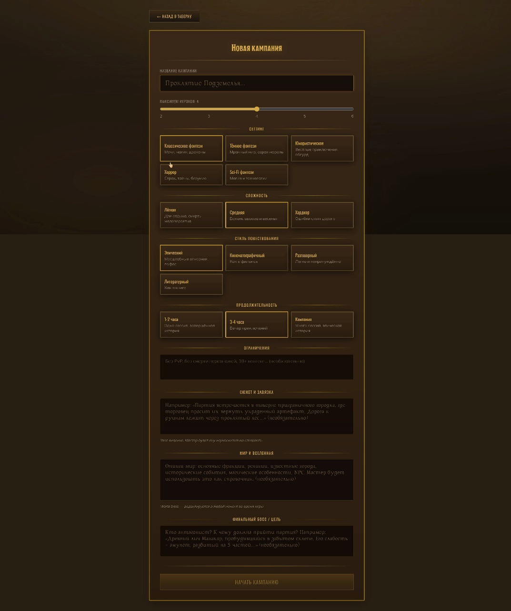

## Создание героя

Мастер создания персонажа проведёт тебя через шесть этапов. Встроенный справочник помогает разобраться в расовых и классовых особенностях.

| Этап | Что выбрать |
| --- | --- |
| **Раса** | Одна из девяти рас; для некоторых доступен выбор подрасы или наследия. |
| **Класс** | Один из двенадцати классов: воин, маг, жрец, плут, паладин и другие. |
| **Характеристики** | СИЛ, ЛОВ, ВЫН, ИНТ, МДР и ХАР. Можно распределить 27 очков Point Buy или бросить 4d6 с исключением наименьшего результата. |
| **Предыстория и мировоззрение** | Прошлое героя, его принципы и отношение к миру. |
| **Имя и аватар** | Имя персонажа и своя картинка с круглым кадрированием, масштабированием и перемещением области. |
| **Итог** | Проверка героя перед созданием. |

После создания Мастер дополнит карточку стартовым снаряжением и особенностями. Дождись окончания подготовки, прежде чем начинать приключение.

Посмотреть все этапы создания героя

**Раса**

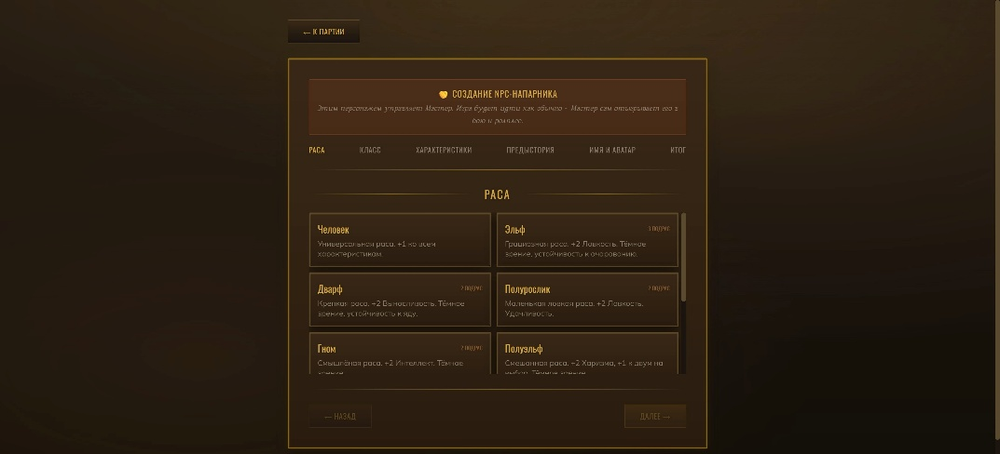

**Класс**

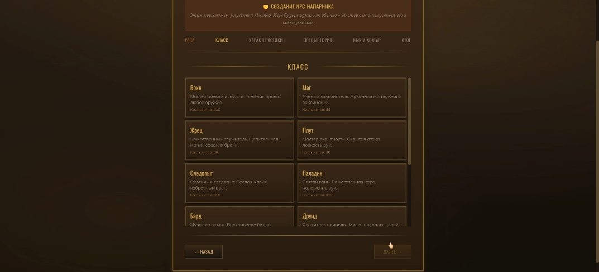

**Характеристики**

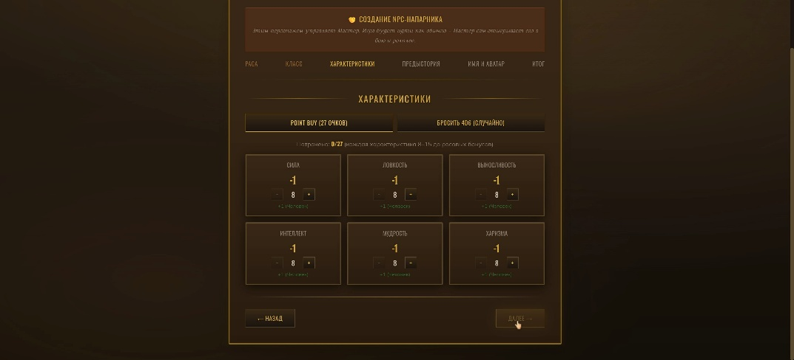

**Предыстория и мировоззрение**

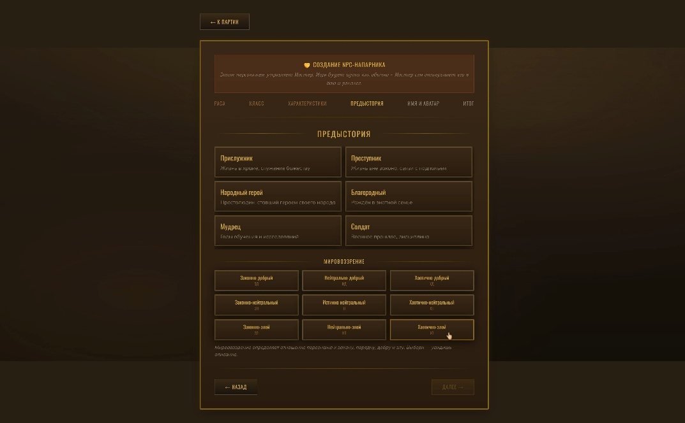

**Имя и аватар**

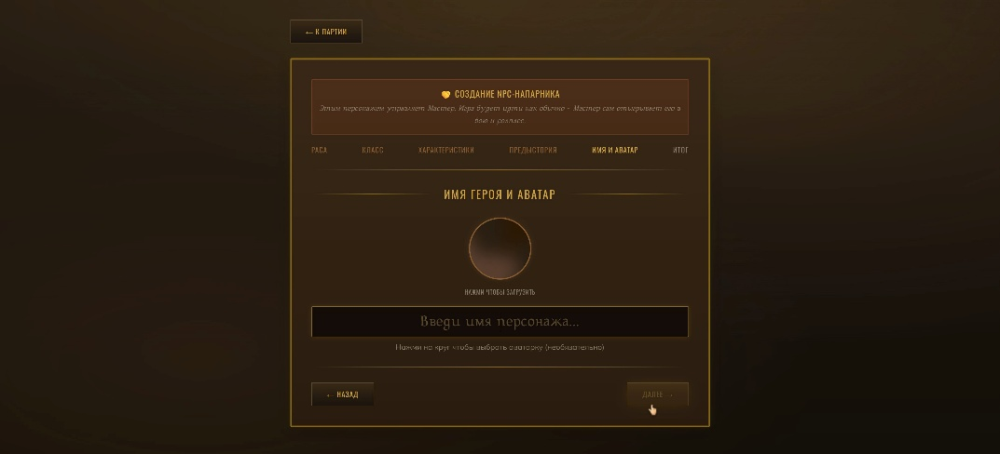

**Итоговая карточка**

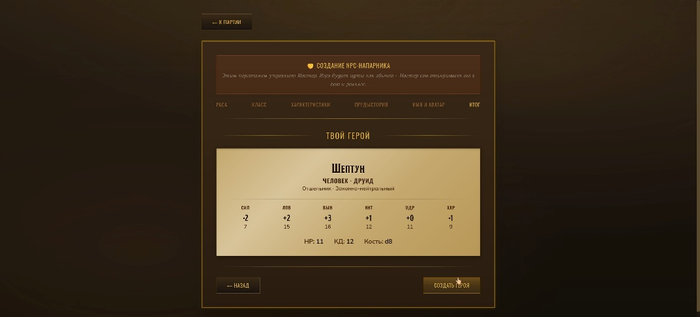

## Игровой стол и первый ход

Вверху находятся название партии и кнопки управления; во время боя под ними появляется **трекер инициативы**. В центре — чат, внизу — герои, NPC, готовность к ходу, кубики и поле ввода.

До старта участники готовят персонажей в прологе. Когда все готовы, создатель нажимает **«Начать»**. Мастер знакомит героев с первой сценой приключения.

Чтобы сделать обычный ход:

1. Опиши намерение героя: «Подхожу к трактирщику и спрашиваю о пропавшем караване» или «Атакую гоблина мечом».
2. Если Мастер попросил проверку, брось нужные кубики.
3. Нажми **«Готов?»**. В группе Мастер продолжит, когда готовы все игроки; счётчик показывает, кого ещё ждут.
4. Дождись ответа. Пока виден индикатор **«Пишем летопись…»**, запрос уже обрабатывается. Время зависит от модели, доступности Google и объёма истории.

Мастер описывает последствия, ведёт NPC и врагов, меняет HP, опыт, деньги, инвентарь и другие игровые показатели. Решения своего героя принимаешь ты. Если Мастер ошибся в правилах или учёте предметов, попроси исправить это через обращение к Мастеру.

В бою трекер показывает порядок инициативы, активного участника и HP. За своего героя кубики бросает игрок, за NPC и врагов — Мастер.

## Чат и кубики

Сообщения Мастера оформлены на пергаменте, сообщения игроков — на тёмном фоне. Системные строки показывают броски, урон, лечение, предметы и награды.

- Начни сообщение с **`//`**, чтобы поговорить вне отыгрыша: оно не попадёт в контекст Мастера.
- Используй **`@Имя`**, чтобы упомянуть персонажа; при наведении доступна его краткая карточка.
- Свои ещё не обработанные сообщения можно редактировать и удалять.
- Прокрути чат вверх для загрузки истории; кнопка новых сообщений вернёт к последним событиям.
- Микрофон позволяет надиктовать текст, если браузер поддерживает распознавание речи и разрешён доступ. Для удалённого доступа к микрофону обычно нужен HTTPS.
- Кнопка **🔊** озвучивает отдельное сообщение.

В корзине кубиков доступны **d2, d4, d6, d8, d10, d12, d20, d100**. Добавь нужные кости, задай модификатор и нажми «Бросить»: например, `2d6+3`. Бросок сопровождается 3D-анимацией, результат виден в чате. Натуральные 20 и 1 у d20 отмечаются отдельными звуками.

## Лист персонажа

Нажми аватар героя, чтобы открыть мини-карточку с HP, характеристиками, КД и уровнем. Кнопка **«Полный лист персонажа»** открывает подробный лист: характеристики, спасброски, навыки, атаки, особенности, языки, деньги и снаряжение.

На отдельных вкладках находятся внешность и предыстория, а также заклинания и их ячейки. Доступные для редактирования поля сохраняются автоматически; часть показателей меняется действиями Мастера.

Посмотреть карточки персонажа

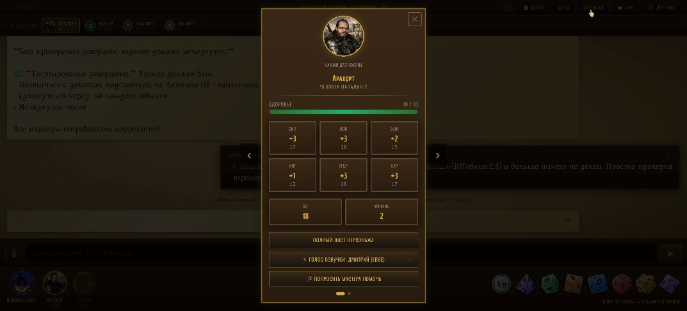

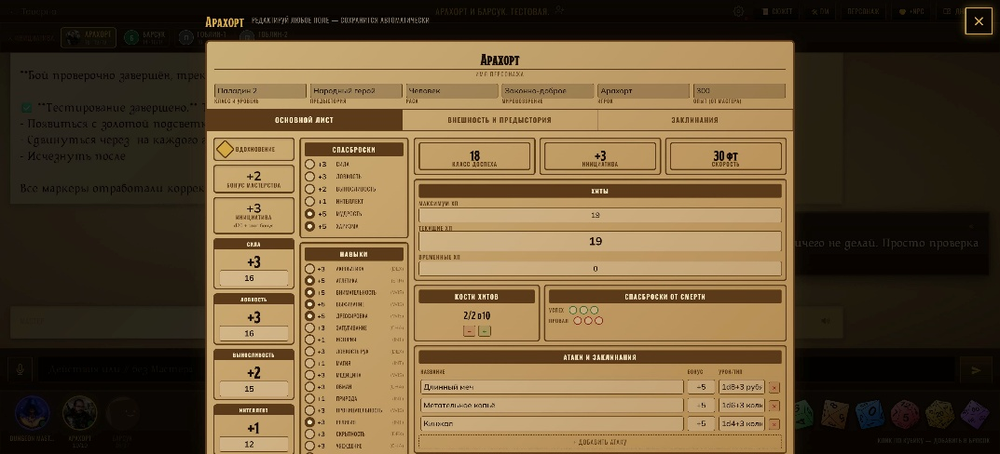

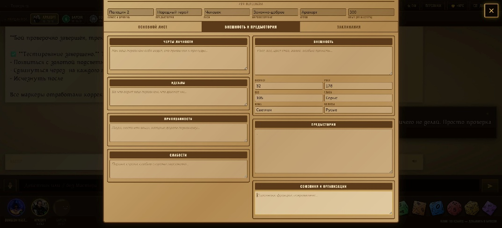

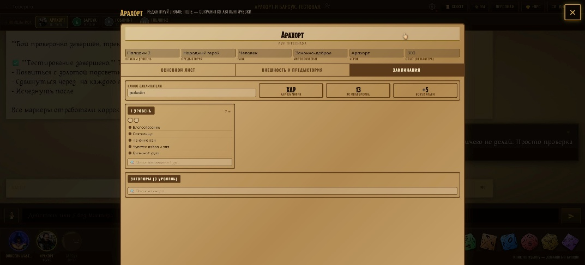

## NPC-напарники

Для одиночного приключения или небольшой группы можно создать напарника кнопкой **«+NPC»**. У него есть полноценный лист персонажа, а его реплики и действия ведёт Мастер.

В поле **«Инструкция Мастеру»** задай манеру речи, привычки, страхи, мотивацию и отношение к героям. Например: «Говорит с южным акцентом, торгуется до последнего, боится магии и предан партии». Инструкция доступна владельцу NPC и Мастеру.

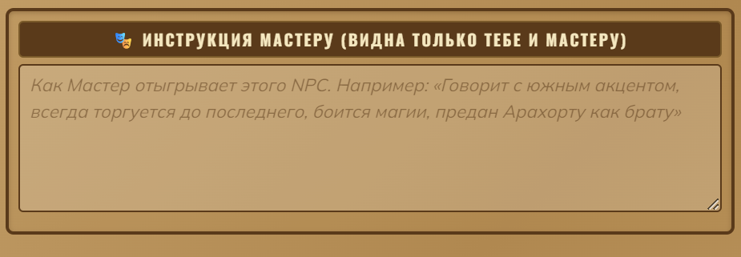

## Карты, иллюстрации и выборы

Мастер может добавлять в сообщения **SVG-карты**: схемы помещений и местности, позиции участников, входы, выходы и опасные зоны. Одна карта видна всей партии. Для сцен доступны иллюстрации; их генерация — отдельный запрос к Google и может занимать больше времени, чем текстовый ответ.

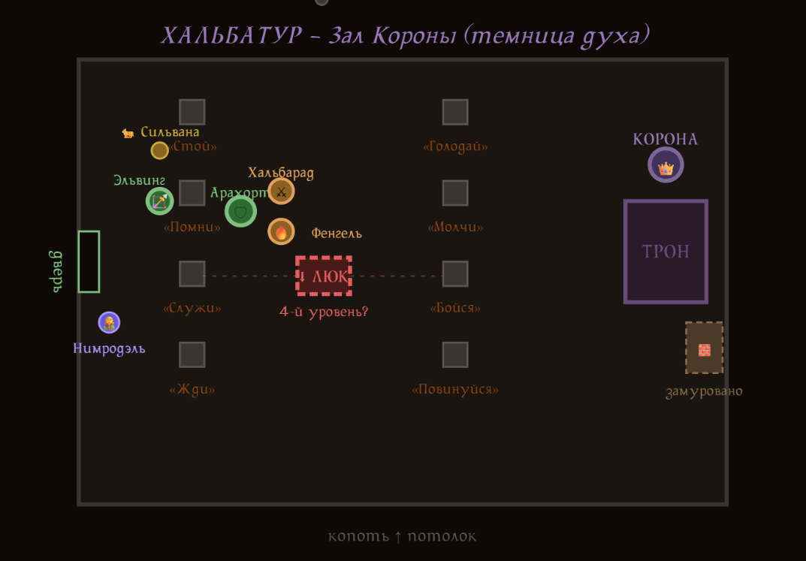

Для отдельных решений используются **кнопки выбора**, а для общих — **голосования** с количеством голосов и полосами прогресса. У заклинаний и предметов может быть подсказка из справочника. Наблюдатели видят голосование, но не участвуют в нём.

## Озвучка, атмосфера и интерфейс

Открой **⚙** в шапке, чтобы настроить звук, громкость, автоматическую озвучку, фоновую атмосферу, шрифт и размер текста. Сцены атмосферы сопровождают таверну, лес, город, подземелье, бой и другие события; Мастер может переключать их по ходу истории.

В этой версии используется **Edge TTS, голос «Дмитрий»**. По умолчанию скорость — **+5%**, высота — **−15 Гц**. Создатель партии может изменить скорость и высоту в разделе **«Сюжет → Голос»**. Включать автоматическое чтение и менять громкость можно у себя; отдельное сообщение озвучивается кнопкой 🔊.

Доступны фэнтезийный шрифт Sirona, Arial, Georgia, Times New Roman, Verdana, системный и моноширинный варианты. Масштаб текста — от 70% до 150%. Личные настройки интерфейса сохраняются в браузере.

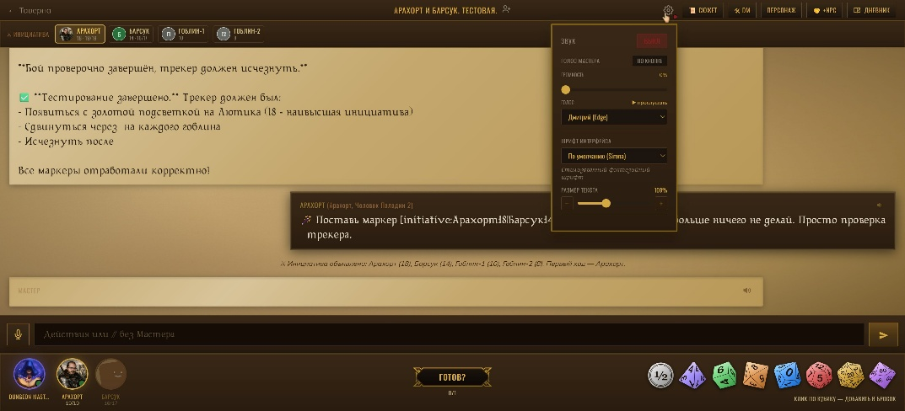

## Дневник кампании

Кнопка **«Дневник»** открывает память приключения: резюме, NPC, квесты, локации, фракции, лор и обещания. Поиск помогает найти нужный факт, а у заданий видно состояние и продвижение.

Мастер пополняет дневник по мере игры. Он доступен участникам партии, включая наблюдателей. Память хранится в PostgreSQL с русским полнотекстовым поиском, без видеокарты и модели эмбеддингов.

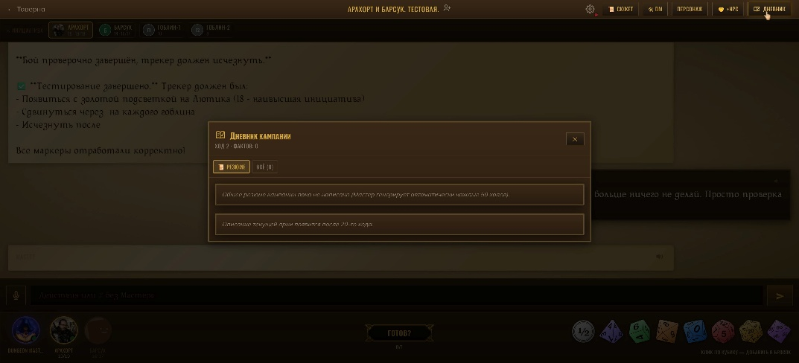

## Управление историей

Создателю партии доступен **«Сюжет» — Советник Мастера**. Здесь можно переименовать приключение, изменить число мест и сложность, дополнить справочник мира, поправить сюжет, настроить голос и экспортировать партию.

Через **«Шепнуть Мастеру»** можно передать подсказку для следующего ответа. Мир и основной сюжет сохраняются отдельно: справочник описывает вселенную, а сюжет задаёт направление истории.

Посмотреть справочник мира и управление сюжетом

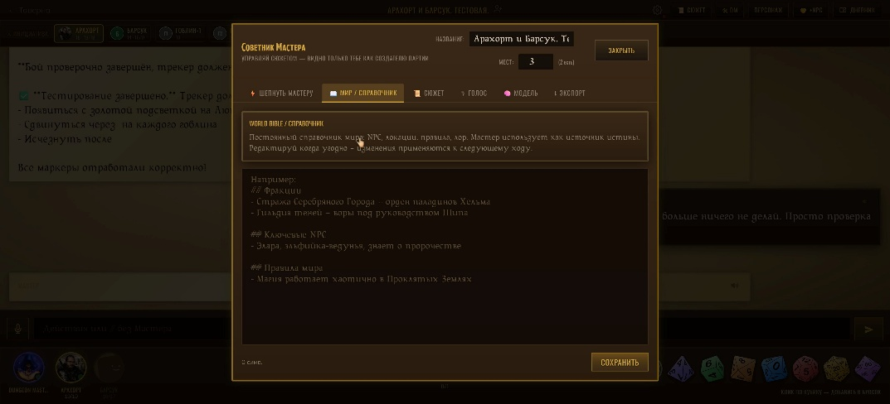

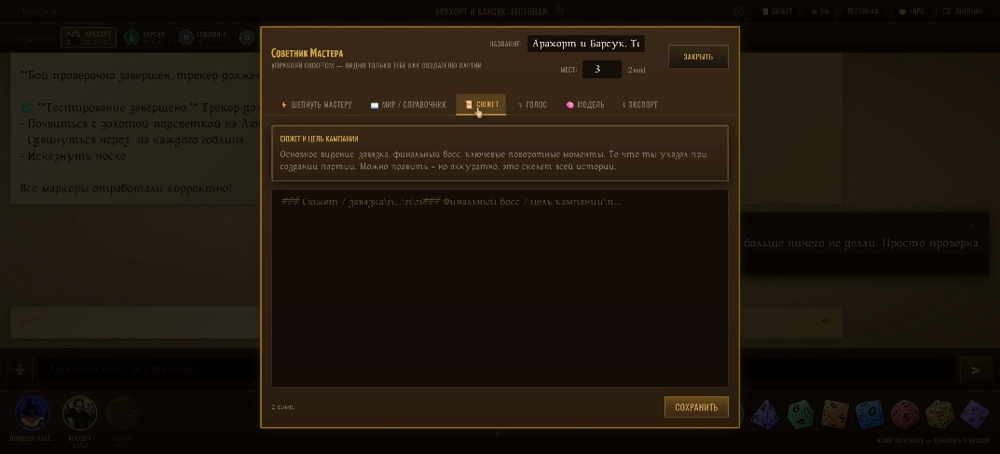

## Наблюдатели

Друг может присоединиться по **коду наблюдателя** и следить за приключением: читать общий чат, смотреть карточки, инициативу и дневник, слушать озвучку. Наблюдатели не пишут в чат, не бросают кубики, не отмечают готовность и не голосуют. Они отображаются отдельно от игроков и не участвуют в сюжете.

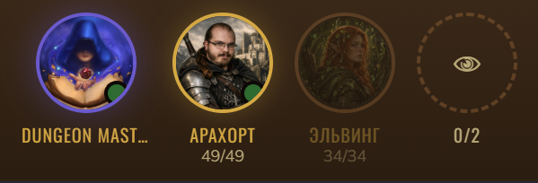

## Экспорт, импорт и администрирование

Партию можно сохранить в ZIP и перенести на другой сервер вместе с персонажами, NPC, историей, дневником и изображениями. Экспорт доступен создателю и администратору, импорт — администратору.

Административный архив переноса содержит аккаунты с хешами паролей. При импорте **совпадающий логин связывается с существующим пользователем**, его пароль и права сохраняются. Отсутствующие аккаунты создаются обычными пользователями с прежними паролями. Храни такие архивы приватно. Подробности и перенос из исходного проекта — в [инструкции по переносу](docs/migration.md).

Администратор также создаёт одноразовые приглашения, проверяет лимиты Google-аккаунта кнопкой **«Проверить лимиты»** и устанавливает обновления. Лимиты показываются по данным AGY `/usage`: группы моделей, остаток недельного и пятичасового лимита, время сброса. Перед обновлением приложение создаёт резервную копию. [Подробнее об обновлениях и восстановлении](docs/updates.md).

## Автор и лицензия

**Arahort** — [arahort.pro](https://arahort.pro), [alex@arahort.pro](mailto:alex@arahort.pro).

Некоммерческое использование — на условиях [LICENSE](LICENSE). В репозитории распространяется готовое приложение для самостоятельной установки.

Владелец сервера открывает в админке вкладку **«Модель и прокси»**: выбирает effort `low`, `medium` или `high`, включает HTTP(S) прокси и сохраняет адрес, порт и учётные данные. Пароль не возвращается в браузер. Клиент AGY может штатно обновлять себя; обновлённая версия сохраняется в постоянной папке контейнера. В разделе лимитов отображается фактическая версия клиента.

## Установка на свой сервер

**[Пошаговая инструкция: установка, домен или IP, прокси и активация Gemini →](docs/setup.md)**
